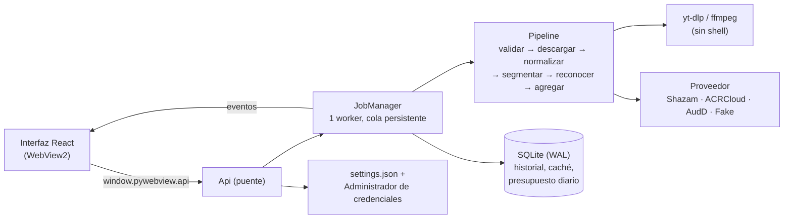

# SetID

Extractor de tracklists de sets de DJ para Windows. Pegas un enlace de YouTube o SoundCloud, o
eliges un archivo de audio, y SetID devuelve el tracklist con marcas de tiempo.

- **App de escritorio** (React en WebView2) y **CLI**.
- Reconocimiento con **Shazam**, **ACRCloud** o **AudD**, con límites de ritmo y presupuesto
  diario de consultas.
- Agregación tolerante a huecos, falsos positivos y transiciones; los tramos sin identificar
  aparecen como `ID – ID`.
- **Tracklist de la comunidad**: lee la descripción y los comentarios del vídeo como
  sugerencias sin verificar.
- Exportación a TXT, CSV, JSON y M3U, con enlaces de búsqueda en Beatport, Spotify y YouTube.
- El audio nunca se guarda: se borra al terminar cada trabajo.

> [!WARNING]
> Herramienta de uso personal. Descargar contenido de YouTube puede contravenir sus términos de
> servicio; la opción recomendada es usar tu propio archivo. El audio nunca se almacena ni se
> redistribuye.

## Requisitos

- Windows 10/11 con WebView2 (viene con Windows 11)
- Python 3.12 y [uv](https://docs.astral.sh/uv/)
- Node.js 22 o superior (solo para compilar la interfaz)
- `ffmpeg` y `ffprobe` en el PATH

## Instalación

```powershell
git clone <url-del-repositorio> SetID
cd SetID\frontend
npm ci
npm run build
cd ..\backend
uv sync --all-extras
```

## Uso

### App de escritorio

```powershell
cd backend
uv run setid-app
```

Pega un enlace o arrastra un archivo de audio a la ventana. El proveedor, las claves de API, el
presupuesto y el resto de ajustes están en la pestaña **Ajustes**.

### Ejecutable

```powershell
cd backend
uv run python scripts/build_app.py --shortcuts
```

Genera `backend\dist\SetID\` con `SetID.exe` (la app) y `setid-cli.exe` (la CLI, que la app
también usa para ejecutar yt-dlp), y crea accesos directos en Inicio y en el Escritorio. Sin
`--shortcuts` solo construye. La CI publica este mismo ejecutable como artefacto en cada push.

### CLI

```powershell
cd backend

# Set sintético para probar sin gastar consultas
uv run setid --make-demo demo.wav
uv run setid --provider fake demo.wav

# Un archivo propio o un enlace
uv run setid --provider shazam "C:\ruta\a\mi-set.mp3"
uv run setid --provider shazam "https://www.youtube.com/watch?v=..."

# Opciones útiles
uv run setid --step 60 --max-queries 100 --json <url|archivo>
uv run setid --no-community <url>
```

La CLI lee la configuración de `backend\.env` (ver [`.env.example`](backend/.env.example)).

## Proveedores

| Proveedor  | Coste                       | Notas                                                           |
| ---------- | --------------------------- | --------------------------------------------------------------- |
| `fake`     | Gratis                      | Determinista. Solo reconoce los tonos del set de demo.          |
| `shazam`   | Gratis                      | **API no oficial** (`shazamio`). Puede dejar de funcionar.      |
| `acrcloud` | Prueba gratuita             | Clave y secreto en Ajustes o en `SETID_ACRCLOUD_*`.             |
| `audd`     | Unas pocas consultas gratis | Token en Ajustes o en `SETID_AUDD_API_TOKEN`. Sin confianza.    |

Un set de una hora con el paso por defecto (30 s) son unas 120 consultas.

## Tracklist de la comunidad

Con enlaces, mientras analiza el audio SetID lee también la descripción y los comentarios más
votados (con sus respuestas) mediante yt-dlp. No hace scraping de otras webs. Reconoce:

- Tracklists publicados (`12:30 Artista - Título`, `[1:02:10] …`, listas numeradas).
- Menciones sueltas (`45:10 Artista - Título 🔥`).
- Preguntas como `23:15 track id?` o «alguien sabe el tema del 1:02:00»: las **respuestas** se
  colocan en ese minuto.
- «unreleased», «forthcoming», «dubplate», «ID», «sin publicar»…, que se marcan como
  unreleased.

Todo aparece en la pestaña **Comunidad** y como sugerencia en los tramos `ID – ID`, siempre
marcado como **sin verificar** y sin mezclarse con lo que identifica la huella. Se desactiva en
Ajustes o con `--no-community`.

## Arquitectura



Los datos de la app viven en `%LOCALAPPDATA%\SetID\`:

| Ruta             | Contenido                                                 |
| ---------------- | --------------------------------------------------------- |
| `setid.db`       | Historial, tracklists, caché y presupuesto diario         |
| `settings.json`  | Ajustes (las claves van al Administrador de credenciales) |
| `logs\setid.log` | Registro en JSON, rotativo y sin secretos                 |
| `tmp\`           | Audio temporal; se borra al terminar cada trabajo         |

```text
SetID/
├── backend/
│   ├── packaging/        Spec de PyInstaller y puntos de entrada del ejecutable
│   ├── scripts/          Build del ejecutable y generación del icono
│   ├── src/setid/
│   │   ├── app/          Ventana de pywebview y puente con la interfaz
│   │   ├── audio/        ffmpeg, segmentación y set de demo
│   │   ├── db/           SQLite, migraciones de Alembic y presupuesto
│   │   ├── jobs/         Cola de trabajos y vistas para la interfaz
│   │   ├── providers/    Shazam, ACRCloud, AudD y proveedor falso
│   │   └── sources/      Validación de URLs y yt-dlp
│   └── tests/
└── frontend/
    └── src/
        ├── api/          Puente tipado y backend simulado para el navegador
        ├── components/   Piezas de la interfaz
        ├── lib/          Formato de tiempos y enrutado
        ├── screens/      Inicio, trabajo y ajustes
        ├── state/        Estado de los trabajos (reducer + contexto)
        └── test/
```

## Desarrollo

Comprobaciones (las mismas que ejecuta la [CI](.github/workflows/ci.yml)):

```powershell
cd backend
uv run ruff check .
uv run ruff format --check .
uv run mypy
uv run pytest

cd ..\frontend
npm run format:check
npm run lint
npm run typecheck
npm test
npm run build
```

Para formatear: `uv run ruff format .` en `backend` y `npm run format` en `frontend`.

Interfaz con recarga en caliente:

```powershell
cd frontend
npm run dev    # en el navegador usa un backend simulado
```

O dentro de la app real, con el servidor de Vite en marcha:

```powershell
cd backend
$env:SETID_DEV_URL = "http://localhost:5173"
uv run setid-app
```

El logo se regenera con `uv run python scripts/make_icon.py` (icono `.ico` y `favicon.svg`).

## Seguridad

El modelo de amenazas (STRIDE), las mitigaciones y los riesgos residuales están en
[SECURITY.md](SECURITY.md).
