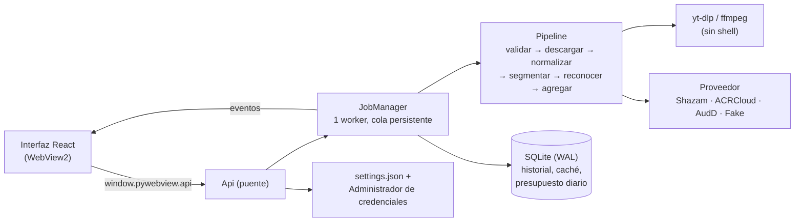

# SetID

Extractor de tracklists de sets de DJ: pegas un enlace de YouTube/SoundCloud o eliges un
archivo de audio y devuelve el tracklist con marcas de tiempo.

> **Estado:** fases 1–3. App de escritorio funcional (pywebview + React). Pendiente: ejecutable
> instalable y CI (fase 4), tracklist de la comunidad (fase 5).

## Arquitectura



Datos de la app en `%LOCALAPPDATA%\SetID\`: `setid.db`, `settings.json`, `logs\setid.log`
(JSON, rotativo) y `tmp\` (audio temporal, se borra al terminar cada trabajo).

> **Aviso legal.** Herramienta de uso personal. Descargar contenido de YouTube puede
> contravenir sus términos de servicio; la opción recomendada es usar tu propio archivo. El
> audio nunca se almacena ni se redistribuye: se borra al terminar cada trabajo.

## Requisitos

- Python 3.12 y [uv](https://docs.astral.sh/uv/)
- Node.js 22+ (solo para compilar la interfaz)
- `ffmpeg` y `ffprobe` en el PATH
- WebView2 (viene con Windows 11)

## Uso (app de escritorio)

En PowerShell, un comando por línea (Windows PowerShell 5 no admite `&&`):

```powershell
cd frontend
npm install
npm run build
cd ..\backend
uv sync --all-extras
uv run setid-app
```

Pega un enlace o arrastra un archivo de audio a la ventana. Los ajustes (proveedor, claves,
presupuesto…) están en la pestaña **Ajustes**.

### Tracklist de la comunidad

Con enlaces, mientras se analiza el audio SetID lee también la descripción y los comentarios
más votados (con sus respuestas) mediante yt-dlp. No hace scraping de otras webs.

- Tracklists publicados (`12:30 Artista - Título`, `[1:02:10] …`, listas numeradas).
- Menciones sueltas (`45:10 Artista - Título 🔥`).
- Preguntas tipo `23:15 track id?` o «alguien sabe el tema del 1:02:00»: las **respuestas** se
  colocan en ese minuto.
- «unreleased», «forthcoming», «dubplate», «ID», «sin publicar»… se marcan como unreleased.

Todo aparece en la pestaña **Comunidad** y como sugerencia en los tramos `ID – ID`, siempre
marcado como **sin verificar** y sin mezclarse con lo que identifica la huella. Se puede
desactivar en Ajustes o con `setid --no-community`.

### Ejecutable (`SetID.exe`)

Para usarla como una app más (con su icono en la barra de tareas y en el Administrador de
tareas, sin abrir terminal):

```powershell
cd backend
uv run python scripts/build_app.py --shortcuts
```

Genera `backend\dist\SetID\` con `SetID.exe` (la app) y `setid-cli.exe` (la CLI, que la app
también usa para ejecutar yt-dlp), y crea accesos directos en Inicio y en el Escritorio. Sin
`--shortcuts` solo construye. Necesita `ffmpeg` en el PATH.

El logo se genera con `uv run python scripts/make_icon.py` (icono `.ico` y `favicon.svg`).

Para trabajar en la interfaz con recarga en caliente:

```bash
cd frontend && npm run dev          # en el navegador usa un backend simulado
SETID_DEV_URL=http://localhost:5173 uv run setid-app   # o dentro de la app real
```

## Uso (CLI)

```bash
cd backend
uv sync --all-extras

# Set sintético para probar sin gastar consultas
uv run setid --make-demo demo.wav
uv run setid --provider fake demo.wav

# Un archivo propio o un enlace
uv run setid --provider shazam "C:\ruta\a\mi-set.mp3"
uv run setid --provider shazam "https://www.youtube.com/watch?v=..."

# Opciones útiles
uv run setid --step 60 --max-queries 100 --json <url|archivo>
```

## Proveedores

| Proveedor  | Coste | Notas |
|------------|-------|-------|
| `fake`     | 0     | Determinista. Solo reconoce los tonos del set de demo. |
| `shazam`   | 0     | **API no oficial** (`shazamio`). Puede dejar de funcionar sin aviso. |
| `acrcloud` | Prueba gratuita | `SETID_ACRCLOUD_*` en `.env`. |
| `audd`     | Unas pocas consultas gratis | `SETID_AUDD_API_TOKEN` en `.env`. Sin puntuación de confianza. |

Un set de 1 h con el paso por defecto (30 s) son ~120 consultas.

## Seguridad

El modelo de amenazas (STRIDE), las mitigaciones y los riesgos residuales están en
[SECURITY.md](SECURITY.md).

## Desarrollo

La CI ([`.github/workflows/ci.yml`](.github/workflows/ci.yml)) ejecuta estos mismos comandos
en cada push y pull request, y construye el ejecutable en Windows como artefacto.

```bash
cd backend
uv run ruff check . && uv run ruff format --check .
uv run mypy
uv run pytest

cd ../frontend
npm run lint && npm run typecheck && npm test && npm run build
```
