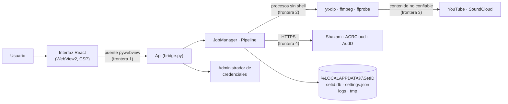

# Seguridad de SetID

SetID es una app de escritorio de uso personal para Windows. No tiene servidor ni cuentas: todo
corre en el equipo del usuario, que es a la vez el único usuario y el administrador. Este
documento resume el modelo de amenazas (STRIDE), las mitigaciones que hay en el código y los
riesgos que se aceptan.

## Comunicar un problema

Abre un *issue* sin detalles explotables y pide un canal privado, o escribe directamente al
autor. No publiques pruebas de concepto antes de que haya una corrección.

## Alcance y fronteras de confianza

| Activo | Dónde vive |
|--------|------------|
| Claves de ACRCloud y AudD | Administrador de credenciales de Windows (`keyring`), o variables de entorno en desarrollo |
| Historial y tracklists | `setid.db` (SQLite) |
| Audio descargado o elegido | `tmp\job-<uuid>\`, solo mientras dura el trabajo |
| Integridad del equipo | Procesos externos lanzados por la app |

**Entradas no confiables:** el enlace que pega el usuario, el archivo que elige o suelta, los
metadatos y comentarios que devuelve yt-dlp (títulos, descripciones…), el propio audio que
procesa ffmpeg y las respuestas de los proveedores de reconocimiento.

**Fuera de alcance:** un atacante con acceso al usuario de Windows (puede leer la base de datos
y el Administrador de credenciales igual que la app) y la seguridad de WebView2, Python o
ffmpeg en sí mismos.

## STRIDE

### Spoofing (suplantación)

| Amenaza | Mitigación |
|---------|------------|
| La ventana carga una web remota que se hace pasar por la interfaz y usa el puente con Python | La ventana solo carga `frontend/dist/index.html` local o, en desarrollo, `SETID_DEV_URL`, que solo admite `http://localhost` o `127.0.0.1` (`app/desktop.py`, `dev_url`). `OPEN_EXTERNAL_LINKS_IN_BROWSER`, `ALLOW_FILE_URLS` y `ALLOW_DOWNLOADS` están desactivados, así que la página no navega fuera de sí misma. |
| Un enlace parecido a YouTube/SoundCloud apunta a otro host (`youtube.com.evil`, `user@host`, puertos…) | Lista blanca **exacta** de hosts, sin credenciales ni puerto, solo `http(s)`, sin espacios, caracteres de control ni `\`, y como mucho 2048 caracteres (`sources/url.py`). |
| Un enlace corto de SoundCloud redirige a un sitio arbitrario | Se resuelve con `follow_redirects=False` y **un único salto**; el destino vuelve a pasar por la lista blanca y tiene que ser un track de SoundCloud (`resolve_source`, `pipeline.http_redirect_resolver`). |
| yt-dlp resuelve la URL con un extractor inesperado | Tras pedir los metadatos se exige `extractor_key` `youtube` o `soundcloud`, `_type` `video`, que no sea un directo y una duración conocida y por debajo del límite (`sources/ytdlp.py`, `parse_metadata`). |

### Tampering (manipulación)

| Amenaza | Mitigación |
|---------|------------|
| Inyección de opciones o comandos en yt-dlp | Nunca se usa shell: `proc.run` exige una lista de `str` y lanza con `shell=False` y `stdin` cerrado (`proc.py`). A yt-dlp solo llega la **URL canónica reconstruida** a partir del ID (se descartan query, fragmento, `list`…), siempre detrás de `--` y con `--ignore-config`, `--no-playlist` y `--no-cache-dir`, así que ninguna configuración local cambia su comportamiento. La salida se fija con `--paths` y `--output source.%(ext)s`: el título del vídeo no decide el nombre del archivo. |
| Un nombre de archivo que empieza por `-` o que cuela un protocolo de ffmpeg (`concat:`, `http:`…) | ffmpeg y ffprobe reciben siempre `file:<ruta absoluta>` (`audio/ffmpeg.py`, `ffmpeg_input`). |
| Un archivo que no es audio (imagen, ejecutable renombrado) | Se valida por contenido con ffprobe, no por extensión: tiene que haber un *stream* de audio, el contenedor no puede ser de imagen, y se aplican límites de tamaño (2 GB) y duración (4 h) (`validate_local_file`). |
| Inyección de SQL | Todo el acceso a SQLite va por SQLModel/SQLAlchemy con consultas parametrizadas. El esquema se gestiona con migraciones de Alembic. |
| `settings.json` corrupto o editado a mano | Solo se leen claves de la lista `EDITABLE_FIELDS`, todo pasa por la validación de Pydantic antes de escribirse y la escritura es atómica (temporal + `replace`). Un archivo roto se ignora (`settings_store.py`). |
| XSS a partir de títulos o comentarios (contenido de terceros) | React escapa todo el texto y no se usa `dangerouslySetInnerHTML`. Los eventos de Python a la página se serializan con `json.dumps(..., ensure_ascii=True)`, que es un literal válido de JavaScript (`event_script`). La CSP del build prohíbe scripts inline y de otros orígenes (ver *Elevation of privilege*). |
| Inyección de fórmulas al abrir el CSV exportado en Excel | Las celdas que empiezan por `=`, `+`, `-`, `@`, tabulador o retorno de carro se prefijan con `'` (`exports.py`, `_csv_safe`). En M3U se eliminan los saltos de línea de los campos, y los nombres de archivo se limpian de caracteres reservados de Windows (`safe_filename`). |

### Repudiation (repudio)

Al ser una app monousuario, el repudio no es un riesgo relevante. Aun así, cada trabajo queda
registrado en `setid.db` (fuente, proveedor, estado, mensajes de error) y los eventos en
`logs\setid.log`, en JSON y con rotación (1 MB × 4) para poder diagnosticar
(`logging_setup.py`).

### Information disclosure (divulgación de información)

| Amenaza | Mitigación |
|---------|------------|
| Claves de API en disco o visibles desde la interfaz | Se guardan en el Administrador de credenciales mediante `keyring`, nunca en `settings.json`. El puente permite **escribirlas pero no leerlas**: `public_view` solo dice si cada clave está configurada (`settings_store.py`, `Api.set_secret`). En memoria van como `SecretStr`. |
| Claves en los logs | El código no registra secretos y, como defensa en profundidad, el formateador JSON tapa `api_token`, `access_key`, `access_secret`, `signature`, `password` y `token` en mensajes, campos extra y trazas (`redact`). Los logs de httpx (que incluyen URLs) se suben a `WARNING`. |
| Errores internos que se filtran a la interfaz | El decorador `_endpoint` devuelve mensajes pensados para el usuario y, ante cualquier otra excepción, un mensaje genérico; el detalle va solo al log (`app/bridge.py`). La salida de error de los procesos se recorta a 2000 caracteres. |
| El audio del usuario o descargado se queda en disco | Cada trabajo usa `tmp\job-<uuid>\`, que se borra en un `finally` aunque el trabajo falle o se cancele, con reintentos por los bloqueos típicos de Windows. Al arrancar se purgan restos de más de 6 h (p. ej. si el proceso murió) (`workdir.py`). |
| Ruta real de un archivo soltado | Solo la conoce Python (`pywebviewFullPath`); la página recibe el trabajo ya creado (`handle_drop`). |
| Envío del audio a terceros | Con Shazam la huella se calcula en local y solo se envía la firma. Con ACRCloud se firma la petición con HMAC y el secreto no viaja. Los proveedores solo reciben fragmentos cortos del set. |
| Datos de navegación en WebView2 | La ventana se abre con `private_mode=True`. |

### Denial of service (denegación de servicio)

| Amenaza | Mitigación |
|---------|------------|
| Un proceso externo colgado | Todos los procesos tienen timeout (metadatos 60 s, descarga y ffmpeg 20 min, comunidad 180 s) y se matan al cancelar el trabajo (`proc.py`, `cancel_event`). |
| Archivos o sets enormes | Límite de 2 GB (también en yt-dlp con `--max-filesize`) y de 4 h de duración; se rechazan playlists y directos. |
| Cola desbordada | Un único *worker* y un máximo de trabajos en cola (`MAX_QUEUED`). |
| Agotar la cuota (o el dinero) de un proveedor | Límites de concurrencia e intervalo por proveedor, *backoff* ante errores y un presupuesto diario de consultas persistido en la base de datos (`config.py`, `db/budget.py`). |
| Entradas grandes por el puente | Textos de 4096 caracteres como máximo y validación de tipos (`MAX_INPUT_LENGTH`). |

### Elevation of privilege (elevación de privilegios)

| Amenaza | Mitigación |
|---------|------------|
| JavaScript de la página llama a métodos internos de Python | pywebview expone todos los métodos públicos del objeto **y de sus atributos públicos**, así que todo el estado de `Api` va en atributos privados (`_manager`, `_store`, `_window`…). Cada método valida tipos, rangos y enums antes de hacer nada (`app/bridge.py`). |
| JavaScript inyectado (XSS) que usa el puente | CSP en el `index.html` del build: `default-src 'self'`, `script-src 'self'`, sin `unsafe-inline` ni `unsafe-eval`, `object-src 'none'`, `base-uri 'none'`, `form-action 'none'`, `frame-src 'none'` (`frontend/vite.config.ts`). |
| Abrir URLs o programas arbitrarios desde la interfaz (`file:///…calc.exe`) | `open_external` solo abre en el navegador del sistema URLs `https` sin credenciales ni puerto y con host en una lista blanca: YouTube, SoundCloud, Beatport y Spotify (`links.py`, `is_allowed_external`). |
| Herramientas de desarrollo en producción | Las DevTools solo se abren con `SETID_DEBUG`. |

## Cadena de suministro y CI

- Dependencias de Python fijadas en `backend/uv.lock` (la CI usa `uv sync --locked`) y de npm
  en `frontend/package-lock.json` (`npm ci`).
- yt-dlp se ejecuta desde el propio entorno (`python -m yt_dlp`, o `setid-cli.exe --yt-dlp` en el
  ejecutable), con la versión del lockfile, no con un yt-dlp cualquiera del PATH.
- La CI (`.github/workflows/ci.yml`) corre con `permissions: contents: read`, sin
  credenciales persistidas en el checkout y con actions fijadas por versión mayor. Ruff aplica
  las reglas de seguridad de Bandit (`S`).

## Riesgos residuales

- **Shazam es una API no oficial** (`shazamio`, obtenida por ingeniería inversa). Puede dejar de
  funcionar o cambiar sin aviso, y su uso está en zona gris respecto a los términos de Shazam.
  Va como extra opcional.
- **Descargar de YouTube puede contravenir sus términos de servicio.** La app lo advierte y
  recomienda usar archivos propios.
- **yt-dlp necesita actualizaciones frecuentes**: los sitios cambian y una versión antigua deja
  de funcionar o puede tener fallos al procesar contenido remoto. Hay que actualizar
  `uv.lock` y reconstruir el ejecutable.
- **ffmpeg y ffprobe se toman del PATH** y no van dentro del ejecutable. Un ffmpeg malicioso o
  vulnerable en el PATH se ejecutaría con los permisos del usuario, y ffmpeg procesa contenido
  no confiable (el audio). Conviene instalarlo de una fuente fiable y mantenerlo actualizado.
- **El host de ACRCloud (`acrcloud_host`) es un ajuste editable sin lista blanca.** Si alguien
  consiguiera ejecutar JavaScript en la interfaz pese a la CSP, podría apuntarlo a otro servidor y
  recibir la *access key* y las firmas (el secreto no se envía). Mejora pendiente: validar que el
  host termine en `.acrcloud.com`.
- **Tracklist de la comunidad sin verificar.** Las descripciones y comentarios son texto de
  terceros; se muestran siempre marcados como *sin verificar* y separados de lo que identifica
  la huella, pero pueden ser erróneos o engañosos.
- **Ejecutable sin firma de código.** Windows SmartScreen lo marcará como desconocido y no hay
  forma de verificar su origen más allá de construirlo uno mismo.
- **Los datos locales no están cifrados.** `setid.db`, `settings.json` y los logs son legibles por
  cualquier proceso del mismo usuario. Contienen títulos y enlaces, no audio ni claves.
